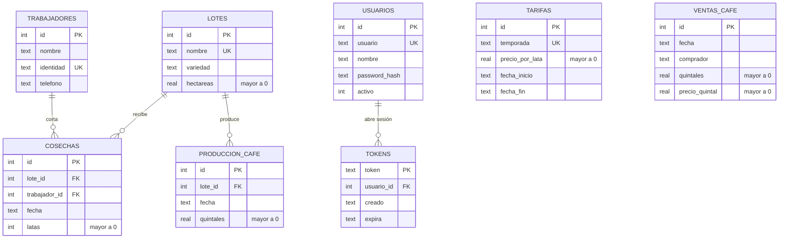

# Finca de café

API y sitio web para una finca cafetalera que paga a los cortadores **por lata** y quiere saber **qué lote rinde más**.
Proyecto individual 14 de Programación III (IS-151), UPH Campus Comayagua.

Con el sistema se puede:

- registrar lotes, trabajadores y cosechas diarias (latas por trabajador, lote y día);
- calcular el pago de cada jornal con la **tarifa vigente de la fecha**;
- sacar la **planilla** de un rango de fechas y el **rendimiento por lote** (latas por hectárea);
- llevar el **café procesado en bodega** de cada lote y **vender café** por quintales y comprador, sin vender más de lo que hay;
- ver cuánto se ha vendido, a quién y a qué precio promedio, y cuánto queda en bodega;
- exportar a CSV y respaldar la base en segundo plano.

## Cómo ejecutarlo

Requiere Python 3.10 o más nuevo.

```bash
python -m venv venv
venv\Scripts\activate          # en Linux/Mac: source venv/bin/activate
pip install -r requirements.txt
uvicorn main:app --reload
```

- Sitio web: <http://127.0.0.1:8000>
- Documentación interactiva de la API: <http://127.0.0.1:8000/docs>
- Usuario de prueba: `admin` / `admin123`

La primera vez que arranca, la API crea `finca.db` ejecutando `crear_bd.sql` (tablas, restricciones y datos de prueba).
Para reiniciar la base de datos, borra `finca.db` y vuelve a arrancar.

### Pruebas

```bash
pytest -v
```

## Estructura por capas

```
main.py            arranque, manejo de errores, sitio web
database.py        conexión SQLite y creación de la base
crear_bd.sql       tablas + datos de prueba
modelos/           clases de dominio (Lote, Trabajador, Tarifa, Cosecha, ProduccionCafe, VentaCafe, Usuario)
repositorios/      patrón Repository: una clase por tabla, heredan de RepositorioBase
esquemas.py        validación de entrada y salida con Pydantic
routers/           endpoints (base.py genera el CRUD; cosechas, auth y reportes son propios)
servicios/         reportes con colecciones, exportar CSV, respaldo en hilo
seguridad.py       protección de endpoints con token
static/            dashboard HTML, CSS y JS
tests/             pruebas con pytest
```

## Diagrama entidad-relación



`COSECHAS` tiene una restricción `UNIQUE (lote_id, trabajador_id, fecha)`: un trabajador tiene un solo registro por lote por día.
Las existencias de café no se guardan: se calculan como `SUM(produccion_cafe) - SUM(ventas_cafe)`.
`TARIFAS` no lleva llave foránea: cada cosecha busca la tarifa cuyo rango de fechas incluye su fecha.

## Diagrama UML de clases

```mermaid
classDiagram
    class Entidad {
        +desde_fila(fila)$
        +a_dict() dict
    }
    class Lote { +id +nombre +variedad +hectareas +rendimiento(latas) float }
    class Trabajador { +id +nombre +identidad +telefono }
    class Tarifa { +id +temporada +precio_por_lata +fecha_inicio +fecha_fin +vigente_en(fecha) bool +se_traslapa_con(inicio, fin) bool +vigente_para(tarifas, fecha)$ Tarifa }
    class Cosecha { +id +lote_id +trabajador_id +fecha +latas +calcular_pago(precio) float }
    class ProduccionCafe { +id +lote_id +fecha +quintales }
    class VentaCafe { +id +fecha +comprador +quintales +precio_quintal +total() float }
    class Usuario { +id +usuario +nombre +password_hash +encriptar(password)$ str +verificar(password) bool }
    Entidad <|-- Lote
    Entidad <|-- Trabajador
    Entidad <|-- Tarifa
    Entidad <|-- Cosecha
    Entidad <|-- ProduccionCafe
    Entidad <|-- VentaCafe
    Entidad <|-- Usuario

    class RepositorioBase {
        +listar(buscar) list
        +obtener(id)
        +obtener_o_404(id)
        +crear(datos)
        +actualizar(id, datos)
        +eliminar(id)
        #validar(datos, id_actual)
    }
    class RepositorioLotes
    class RepositorioTrabajadores
    class RepositorioTarifas { +vigente_en(fecha) Tarifa }
    class RepositorioCosechas { +listar_detalle() list +entre_fechas(desde, hasta) list }
    class RepositorioProduccion { +listar_detalle() list }
    class RepositorioVentas { #validar() no vender más de lo que hay }
    class RepositorioUsuarios { +por_nombre(usuario) Usuario }
    RepositorioBase <|-- RepositorioLotes
    RepositorioBase <|-- RepositorioTrabajadores
    RepositorioBase <|-- RepositorioTarifas
    RepositorioBase <|-- RepositorioCosechas
    RepositorioBase <|-- RepositorioProduccion
    RepositorioBase <|-- RepositorioVentas
    RepositorioBase <|-- RepositorioUsuarios

    class ServicioReportes { +planilla(desde, hasta) dict +rendimiento_lotes() list +inventario() dict +ventas_resumen() dict +resumen() dict }
    class HiloRespaldo { +run() +detener() }
    ServicioReportes ..> RepositorioCosechas
    ServicioReportes ..> RepositorioTarifas
```



## Reglas de negocio

| Regla | Dónde se valida |
|---|---|
| Las latas son mayores a cero | Pydantic (`gt=0`), `CHECK (latas > 0)` en SQL |
| Un trabajador tiene un solo registro por lote por día | `RepositorioCosechas.validar` y `UNIQUE` en SQL |
| El pago usa la tarifa vigente de la fecha | `Tarifa.vigente_para` + `Cosecha.calcular_pago` |
| No se registra una cosecha sin tarifa vigente | `RepositorioCosechas.validar` |
| Dos tarifas no se traslapan en fechas | `RepositorioTarifas.validar` |
| No se vende más café del que hay en bodega | `RepositorioVentas.validar` |
| No se borra ni se baja un ingreso de café que ya se vendió | `RepositorioProduccion` |
| No se elimina un lote o trabajador con cosechas | llave foránea `ON DELETE RESTRICT` |
| No se elimina una tarifa que usan cosechas | `RepositorioTarifas.eliminar` |

## Endpoints principales

Todos piden `Authorization: Bearer <token>` salvo el login.

| Método | Ruta | Para qué sirve |
|---|---|---|
| POST | `/auth/login` | Entrar y recibir el token |
| GET, POST, PUT, DELETE | `/lotes`, `/trabajadores`, `/tarifas`, `/cosechas`, `/produccion`, `/ventas` | CRUD (`?buscar=` en los listados) |
| GET | `/planilla?desde=&hasta=` | **Reto propio:** pago por trabajador y rendimiento por lote (latas por hectárea) |
| GET | `/reportes/rendimiento-lotes` | Rendimiento por lote, con rango opcional |
| GET | `/inventario` | Café en bodega: producido, vendido y disponible, por lote |
| GET | `/reportes/ventas` | Ventas por comprador y por mes, con precio promedio |
| GET | `/reportes/resumen` | Totales y agrupaciones de toda la finca |
| GET | `/exportar/{lotes,trabajadores,tarifas,cosechas,produccion,ventas,planilla}` | Descarga en CSV |
| POST, GET | `/respaldos` | Lanzar un respaldo en un hilo / ver los respaldos |

Códigos HTTP: 200 (consulta o cambio correcto), 201 (creado), 400 (dato inválido o regla de negocio rota), 404 (no existe), 401 (sin sesión).

## Capturas

Agrega aquí las capturas del sitio (inicio de sesión, cosechas, planilla con el rendimiento por lote) en una carpeta `capturas/`.
